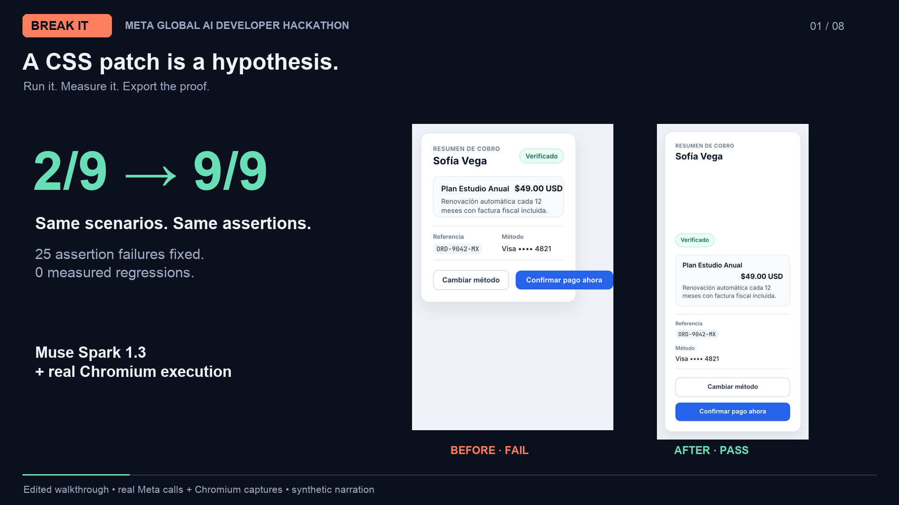

# BREAK IT

**Find the content that breaks your UI. Then prove the fix.**

[Watch the 2:42 demo](https://raw.githubusercontent.com/OsmarGHz/break-it/main/demo/BREAK-IT-demo.mp4) · [45-second cut](https://raw.githubusercontent.com/OsmarGHz/break-it/main/demo/BREAK-IT-X-45s.mp4) · [Matching demo evidence ZIP](demo/recorded-demo-evidence.zip) · [Deploy to Heroku](https://www.heroku.com/deploy?template=https://github.com/OsmarGHz/break-it)



The videos are edited actual app / Chromium captures with synthetic narration. The recorded demo uses fresh Meta calls and improves **2/9 → 9/9** on the same pack, fixing 25 assertion failures with 0 measured regressions. Its standalone ZIP was independently rerun. Earlier archived examples below have different generated packs and scores. This is declared-layout verification on intentionally fragile examples, not a general repair benchmark.

Adversarial stress-testing workbench for static HTML/CSS components, built for the Meta Global AI Developer Hackathon (November 4, 2026).

`Muse Spark 1.3` proposes realistic adversarial content/viewport scenarios and scoped CSS patches; **Playwright Chromium** executes every scenario in an isolated offline browser context, evaluates explicit geometric layout assertions, captures real PNG evidence, and replays **precisely the same locked scenario and assertion pack** against any proposed CSS fix. Model claims never mark a test as passed.

---

## Proof you can rerun without an API key

Two archived runs include actual `muse-spark-1.3` receipts, unchanged model CSS, PNGs, and a standalone Chromium evaluator. After installing dependencies and Chromium:

```bash
npm run verify:evidence
```

This **rerenders recorded model outputs** in a real browser. It does not call Meta again. Original checkout: **3/9 → 9/9**; custom boarding pass: **0/9 → 9/9**. These are two intentionally fragile examples, not a general repair benchmark. Both original targets must exit 1 and both candidates exit 0. The script verifies these expectations.

Download individual evidence bundles from [examples/](examples/). To generate fresh scenarios and CSS, configure your own key and use the workbench below.

## Quick Start

Requires Node.js 22 or newer.


### 1. Install dependencies & Chromium
```bash
git clone https://github.com/OsmarGHz/break-it.git
cd break-it
npm ci
npx playwright install --with-deps chromium
```

### 2. Configure Meta Model API (server-side only)
```bash
cp .env.example .env.local
```
Edit `.env.local` and set your Meta key:
```dotenv
MODEL_API_KEY=your_meta_model_api_key_here
META_BASE_URL=https://api.meta.ai/v1
META_SPARK_MODEL=muse-spark-1.3
```
- `.env.local` is gitignored and read **server-side only** (`server/config.ts`). It is re-checked dynamically per request, so you do not need to restart the dev server after adding `MODEL_API_KEY`.
- Vite uses `envPrefix: 'BREAKIT_PUBLIC_'` so `MODEL_API_KEY` is never exposed to client bundles, screenshots, error banners, or exported archives.
- **Data transmission notice:** When you click a **Muse Spark 1.3** button in the UI, the selected component HTML/CSS, reviewed slot metadata, failing geometric measurements, and up to 3 failure PNG screenshots are sent from the local Node server to `META_BASE_URL`. Local secrets and unrelated files are never sent.

### 3. Run the workbench locally
```bash
npm run dev
```
- **Frontend Workbench:** `http://127.0.0.1:5173`
- **Local Node + Chromium API:** `http://127.0.0.1:4174`

---

## Verification & Test Commands

```bash
# Run 12 tests: Chromium checks, export parity, provenance, access protection and async jobs
npm test

# Run CLI verification of the fragile vs. corrected Checkout Card fixture pair in Chromium
npm run verify:fixtures

# Run live Muse Spark 1.3 E2E verification (bundled Checkout fixture + custom Boarding Pass component + export parity)
npm run verify:spark

# Run end-to-end Playwright browser walkthrough against http://127.0.0.1:5173 (requires `npm run dev` running)
npm run verify:ui

# Typecheck + production Vite bundle build
npm run build
```

---

## Complete Workflow

1. **Load or Paste a Static Component (`1. Component & Invariants`):**
   - Choose a bundled fragile component (`Checkout Order Summary Card` or `Creator Payout Approval Card`) or paste owned static HTML/CSS.
   - Untrusted input is sanitized (`server/sanitizer.ts`): `<script>`, `<iframe>`, `<object>`, `<meta>`, `<link>`, inline `on*` handlers, `javascript:` URLs, `@import`, and external URLs are stripped before rendering.
   - Review detected `data-breakit-id` text/control slots and declared layout invariants (`no_viewport_overflow`, `cta_visible_in_bounds`, `text_not_clipped`, `controls_separated`), including optional reviewed `allowEllipsis` / `allowOverlap` exceptions.
2. **Generate Adversarial Scenarios:**
   - Click **Generate Cases with Muse Spark 1.3** (`POST /api/spark/scenarios`) for 6–12 schema-constrained adversarial cases (Spanish/English compound names, unbroken settlement/routing tokens, multi-line disclosures, and 320px narrow viewports), or load the deterministic local starter pack when testing offline without an API key.
3. **Execute in Real Chromium (`2. Failure Matrix & Evidence`):**
   - Each scenario renders in a fresh Playwright Chromium context (`javaScriptEnabled: false`, bundled offline WOFF2 `Inter` & `JetBrains Mono` fonts, all network requests aborted via `context.route`).
   - Inspect real PNG captures with sub-pixel SVG geometric failure overlays (`scrollWidth`, viewport boundary, card bounds, overflowing text glyph ranges, and clipping ancestors).
4. **Propose Candidate CSS, Provenance & Diff (`3. Candidate Patch & Diff`):**
   - Click **Ask Muse Spark 1.3 for Scoped CSS Fix** (`POST /api/spark/patch`), which sends the component HTML/CSS, failing geometric measurements, and up to 3 real failure PNG captures (`image_url` base64 data URLs inside the `user` message) and returns a scoped CSS replacement (`source: 'muse_spark'`) + immutable `sparkGeneratedCssHash` + rationale + unified `.diff`.
   - If you manually edit a Spark-generated stylesheet, attribution automatically transitions to `muse_spark_modified` (retaining `originReceipt` as starting-point provenance rather than claiming the final edited CSS came verbatim from Muse Spark, with one-click **Restore Exact Spark CSS**).
5. **Replay Identical Pack & Export (`4. Before / After Proof`):**
   - Replaying (`POST /api/runs/:runId/retest`) locks the original HTML, slots, scenarios, and assertions (`packHash` verified). Any remaining failures stay prominently listed.
   - Click **Export Bundle (.zip)** to download `manifest.json`, `original.html`, `original.css`, `candidate.css`, `patch.diff`, `scenarios.json`, `assertions.json`, `slots.json`, before/after PNGs, secret-free model receipts, and a standalone runnable script (`node repro/reproduce.mjs`) compiled directly from the shared `server/evaluator-core.ts` engine + embedded offline fonts.

---

## Observed Live Verification Results (`muse-spark-1.3` + `Chromium 156.0.8078.4`)

1. **Bundled Fixture — `Checkout Order Summary Card (Fragile)` (Live Muse Spark 1.3):**
   - **Scenario Generation:** `9` scenarios (`1` baseline + `8` generated by `muse-spark-1.3`, `responseId=chatcmpl-01a1a8bf-9cf8-70f7-ac24-1a47358fdd40`, `packHash=532aae114a4c7fcc`).
   - **Original Fragile Run:** `3/9` scenarios passed, `6/9` failed (`21` assertion failures across `117` measured checks).
   - **Unmodified Muse Spark CSS Patch (`cand_4040b78c-d`, `cssHash=f1d15a7a8d441256`):** Proposed with `3` real failure PNGs attached (`responseId=chatcmpl-01a1a8c0-2743-7626-a027-e622a7f9e58d`).
   - **Locked Replay & Export Parity:** `9/9` scenarios passed (`117/117` assertions passed, `+6` scenarios fixed, `0` regressions, `0` remaining failures). Standalone `node repro/reproduce.mjs` verified (`--target original` exit `1`, `--target candidate` exit `0`).
2. **Custom Component Outside Bundled Fixtures — `Custom Airline Boarding Pass` (Live Muse Spark 1.3):**
   - **Scenario Generation:** Auto-instrumented `14` slots and `13` assertions from raw HTML/CSS; `muse-spark-1.3` generated `8` adversarial scenarios (`9` total with baseline, `responseId=chatcmpl-01a1a8c0-8f80-7460-8969-fde19dec82c9`, `packHash=72d55879728a9241`).
   - **Original Fragile Run:** `0/9` scenarios passed, `9/9` failed (`38` assertion failures — including `content-box` width overflow, compound passenger name + gate pill expulsion, unbroken e-ticket token spill, fixed `40px` advisory vertical clipping, and `320px` CTA overflow).
   - **Unmodified Muse Spark CSS Patch (`cand_4ae04c6d-0`, `cssHash=8fafe5d7ae7ad033`):** Proposed with `3` real failure PNGs attached (`responseId=chatcmpl-01a1a8c1-1d8f-741c-9f0c-9ad92a513b58`).
   - **Locked Replay & Export Parity:** `9/9` scenarios passed (`117/117` assertions passed, `+9` scenarios fixed, `+38` assertions fixed, `0` regressions, `0` remaining failures). Standalone `node repro/reproduce.mjs` verified (`--target original` exit `1`, `--target candidate` exit `0`).

---

## Explicit Boundaries & Limitations

- **Layout geometry only:** Passing BREAK IT's checks confirms only the declared geometric invariants (horizontal overflow within rounding tolerance, CTA visibility/containment/center hit-test, required slot non-clipping, and control separation) on the executed scenarios. It does **not** certify WCAG accessibility, color-contrast compliance, application logic, security, or production readiness.
- **Intentional design patterns:** Intentional `text-overflow: ellipsis` or overlapping decorative elements will fail strict clipping/separation rules unless explicitly marked as reviewed exceptions in Step 1.
- **Static HTML/CSS scope:** Arbitrary live URLs, authenticated crawling, user JavaScript execution, and framework project imports are intentionally out of scope.


## Single-server build and Docker

```bash
npm run build
npm start
# Open http://127.0.0.1:4174 — UI and API on the same origin.
```

Optional container (Docker build not exercised on the author's Mac, which has no Docker runtime):

```bash
docker build -t break-it .
docker run --rm --init --ipc=host -p 127.0.0.1:4174:4174 --env-file .env.local break-it
```

The Playwright image version matches the pinned package, following [Playwright's Docker guidance](https://playwright.dev/docs/next/docker). `.dockerignore` excludes credentials and local artifacts. The container runs as `pwuser`. Keep the loopback port binding for local use. Set DEMO_PASSWORD in the server environment to enable HTTP Basic access (username judge). Heroku startup requires this password. This MVP has no per-user quotas or multi-tenant isolation; share access only with intended reviewers. No public interactive server is claimed in this submission.

## What was built and what is reused

Built for this hackathon: text-slot instrumentation and reviewed invariant workflow, Meta scenario/patch integration, geometric failure evidence, locked replay/comparison, candidate provenance, and a portable proof bundle sharing the evaluator. React/Vite, Express, Playwright Chromium, Cheerio, Zod, JSZip, esbuild, Lucide and bundled Inter/JetBrains Mono are existing open-source dependencies. Development was assisted by Antigravity and Codex. The product uses **Muse Spark 1.3 via Meta Model API**; it does not use Muse Image, Muse Code, Gemini, Fireworks, Modal, or Baseten.

## Security and execution scope

Designed for a local, single-user workbench processing owned static components. Sanitization, disabled script execution and blocked network requests reduce exposure; they are not a security boundary for a public multi-user browser execution service. Exported screenshots and component source may contain the data you supplied. Inspect them before sharing.


## Heroku demo deployment (configuration prepared; not yet deployed)

[Deploy to Heroku](https://www.heroku.com/deploy?template=https://github.com/OsmarGHz/break-it)

The deployment form uses `app.json`: **one Basic web dyno, no add-ons**, with a Meta key and a separate demo password entered directly in Heroku. Review the billing estimate and verify any student credits before confirming. Basic currently costs up to US$7/month; a student's actual available monthly credit depends on their account. The container's memory footprint must be verified after deployment.

Heroku can build the container remotely using `heroku.yml` on a **Cedar-generation** app with the `container` stack, so a local Docker installation is optional. Connect this GitHub repository in Heroku or deploy its main branch using Heroku Git after selecting that stack. See [Heroku's manifest instructions](https://devcenter.heroku.com/articles/build-docker-images-heroku-yml).

Set **Config Vars** in Heroku Settings (never in GitHub): `MODEL_API_KEY`, `DEMO_PASSWORD` (a separate review password), `META_BASE_URL=https://api.meta.ai/v1`, `META_SPARK_MODEL=muse-spark-1.3`. Start with one Basic web dyno and verify browser memory before increasing resources. No database or third-party add-ons are needed.

The server honors Heroku's `PORT`, binds to `0.0.0.0` inside the container, stores transient artifacts in `/tmp/break-it`, and limits Chromium to one context at a time. The UI submits long operations as jobs (HTTP 202) and polls for results, avoiding Heroku's [30-second request timeout](https://devcenter.heroku.com/articles/request-timeout). Jobs and artifacts disappear on dyno restart; export the ZIP during the session. Use exactly one web dyno: this MVP has no shared job store.

Reviewer access uses HTTPS + HTTP Basic authentication: username `judge`, password supplied privately with the submission. The health endpoint exposes configuration status, never credentials. The demo is for a few invited reviewers; it is not a public multi-user service.
