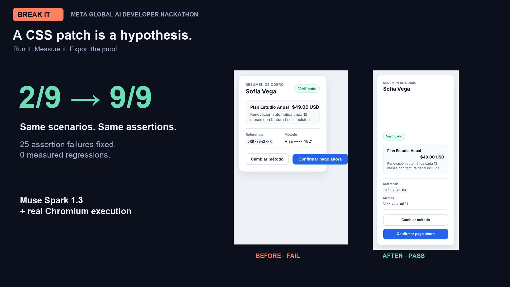

# BREAK IT

[](https://www.typescriptlang.org/)
[](https://react.dev/)
[](https://playwright.dev/)
[](https://nodejs.org/)
[](https://github.com/OsmarGHz/break-it/actions/workflows/ci.yml)
[](LICENSE)

**Find the content that breaks your UI. Then prove the fix.**

An adversarial layout stress-testing workbench for static HTML/CSS components powered by **Playwright Chromium** and **Meta Muse Spark 1.3** *(originally created for the Meta Global AI Developer Hackathon)*.



[Watch 45s actual app capture (MP4)](https://raw.githubusercontent.com/OsmarGHz/break-it/main/demo/app-walkthrough.mp4) · [Download archived evidence bundles](examples/)

---

## Why BREAK IT?

Components often look clean with short placeholder copy, then break in production under long multilingual names, unbroken account tokens, multi-line legal copy, or narrow 320px viewports.

Instead of trusting an LLM's self-reported verdict, **BREAK IT treats every CSS fix as a falsifiable hypothesis**:

1. **Generate adversarial cases** — `Muse Spark 1.3` proposes schema-constrained content mutations and viewport sizes (or use the deterministic offline starter pack without an API key).
2. **Measure in real Chromium** — Playwright executes every scenario in an isolated offline browser context, evaluates explicit geometric layout invariants, and captures real PNG screenshots with sub-pixel failure overlays.
3. **Propose a multimodal CSS patch** — Failing geometric measurements plus up to 3 failure PNGs are sent to `Muse Spark 1.3`, returning a scoped CSS candidate and unified diff.
4. **Prove with locked replay & portable export** — Replaying locks the exact original HTML, slots, scenarios, and assertions (`packHash` verified) and exports a standalone `.zip` proof bundle with an executable `repro/reproduce.mjs` script.

---

## Architecture

```text
Static HTML/CSS Component
        │
        ▼
server/sanitizer.ts ──► Strip scripts, handlers, external URLs; instrument data-breakit-id slots
        │
        ├──► server/spark.ts (optional) ──► Muse Spark 1.3 schema-validated adversarial scenarios
        │
        ▼
server/renderer.ts + server/evaluator-core.ts
  • Isolated Playwright Chromium (JS disabled, offline bundled Inter/JetBrains Mono fonts, network aborted)
  • Geometric invariants: viewport overflow, CTA visibility/hit-test, text clipping, control separation
        │
        ├──► Failure Matrix & Sub-Pixel SVG Overlays (React 18 + Vite Workbench)
        ├──► Multimodal CSS Patch Proposal + Immutable Provenance Hashing (sparkGeneratedCssHash)
        ├──► Locked Identical-Pack Replay (server/comparison.ts, packHash verified)
        └──► Standalone Proof Bundle (.zip) with compiled repro/reproduce.mjs (server/exporter.ts)
```

---

## Key Engineering Highlights

- **Computed invariants, not AI verdicts:** Every pass/fail status is measured in real Chromium (`no_viewport_overflow`, `cta_visible_in_bounds`, `text_not_clipped`, `controls_separated`), including optional user-reviewed `allowEllipsis` / `allowOverlap` exceptions.
- **Anti-evasion checks:** Patches that hide required elements (`display: none`, `opacity: 0`, `font-size: 0`, off-screen clipping) are automatically detected and rejected as failures.
- **Strict sandbox isolation for untrusted HTML/CSS:** `server/sanitizer.ts` strips `<script>`, `<iframe>`, `<object>`, `<meta>`, `<link>`, inline `on*` handlers, `javascript:` URIs, `@import`, and remote asset URLs; Chromium runs with `javaScriptEnabled: false` and all external network requests aborted via `context.route`.
- **Immutable patch provenance:** Generated CSS carries an immutable `sparkGeneratedCssHash`. Manual user edits automatically transition attribution from `muse_spark` to `muse_spark_modified` (with one-click restore), preventing forged model attribution.
- **Export parity via shared evaluator core:** `server/exporter.ts` bundles `server/evaluator-core.ts` using `esbuild` along with embedded offline WOFF2 fonts so the exported `repro/reproduce.mjs` produces bit-for-bit identical evaluation logic outside the app.
- **Production-ready Express backend:** Zod schema validation, deferred async job queue (`HTTP 202` + polling) for long Chromium runs, automatic secret redaction in logs/responses, optional HTTP Basic protection (`DEMO_PASSWORD`), and a read-only `/review` recorded-proof viewer with strict CSP headers.

---

## Verify Without an API Key

You can replay two real archived runs (real `muse-spark-1.3` receipts, unchanged model CSS, PNGs, and standalone Chromium evaluator) completely offline:

```bash
git clone https://github.com/OsmarGHz/break-it.git
cd break-it
npm ci
npx playwright install --with-deps chromium

# Replays archived original (exit 1) and candidate (exit 0) bundles in real Chromium
npm run verify:evidence
```

### Recorded Verification Benchmarks (`muse-spark-1.3` + Playwright Chromium)

| Component | Scenarios (Before → After) | Assertions Fixed | Regressions | Standalone `reproduce.mjs` |
| :--- | :---: | :---: | :---: | :---: |
| **Checkout Order Summary Card** *(bundled fixture)* | **3/9 → 9/9** | 21 / 117 | 0 | Verified (`1` → `0`) |
| **Custom Airline Boarding Pass** *(external component)* | **0/9 → 9/9** | 38 / 117 | 0 | Verified (`1` → `0`) |

*(These are declared-layout checks on intentionally fragile static components, not a general CSS repair benchmark.)*

---

## Quick Start

Requires **Node.js 22+**.

### 1. Install dependencies & Chromium

```bash
npm ci
npx playwright install --with-deps chromium
```

### 2. Configure Meta Model API *(optional — needed only for live Muse Spark calls)*

```bash
cp .env.example .env.local
```

Edit `.env.local` (gitignored, loaded server-side only via `server/config.ts`):

```dotenv
MODEL_API_KEY=your_meta_model_api_key_here
META_BASE_URL=https://api.meta.ai/v1
META_SPARK_MODEL=muse-spark-1.3
```

- Vite restricts client env exposure via `envPrefix: 'BREAKIT_PUBLIC_'`, ensuring `MODEL_API_KEY` is never exposed to client bundles, screenshots, or exported ZIPs.
- **Offline mode:** Without a key, you can still run the full Chromium stress-testing, manual CSS patching, locked replay, and ZIP export loop using the deterministic local scenario preset, or inspect the archived proof at `/review`.

### 3. Run locally

```bash
npm run dev
```

- **Interactive Workbench:** `http://127.0.0.1:5173`
- **Node + Chromium API & Recorded Proof Viewer:** `http://127.0.0.1:4174/review`

---

## Test & Verification Commands

```bash
# Typecheck + production Vite build
npm run build

# Run 13 Vitest + Chromium tests (layout checks, anti-evasion, XSS/network isolation, export parity, provenance, async jobs, auth)
npm test

# Replay archived real-Meta evidence ZIPs offline in Chromium
npm run verify:evidence

# Verify bundled fragile vs. corrected fixture pair in Chromium
npm run verify:fixtures

# End-to-end live Muse Spark 1.3 verification (requires MODEL_API_KEY)
npm run verify:spark

# Browser UI walkthrough against local dev server (requires `npm run dev`)
npm run verify:ui
```

---

## Production Build & Docker

Run UI and API from a single Express server:

```bash
npm run build
npm start
# Open http://127.0.0.1:4174
```

Or run in Docker using the pinned Playwright image (`Dockerfile` runs as non-root `pwuser` with single-context Chromium concurrency):

```bash
docker build -t break-it .
docker run --rm --init --ipc=host -p 127.0.0.1:4174:4174 --env-file .env.local break-it
```

Set `DEMO_PASSWORD` in the environment to protect `/workbench` and write API endpoints with HTTP Basic Auth (username: `judge`) while keeping `/review` and `/api/health` accessible.

---

## Scope & Limitations

- **Layout geometry only:** Passing checks confirms the declared geometric invariants on the executed scenarios; it does not certify WCAG accessibility, color contrast, application logic, or security.
- **Intentional design patterns:** Intentional `text-overflow: ellipsis` or overlapping decorative badges fail strict checks unless explicitly marked as reviewed exceptions in Step 1.
- **Static HTML/CSS scope:** Live URL crawling, authenticated web apps, arbitrary user JavaScript execution, and multi-tenant isolation are intentionally out of scope.

---

## License

Distributed under the MIT License. See [LICENSE](LICENSE) for details.
